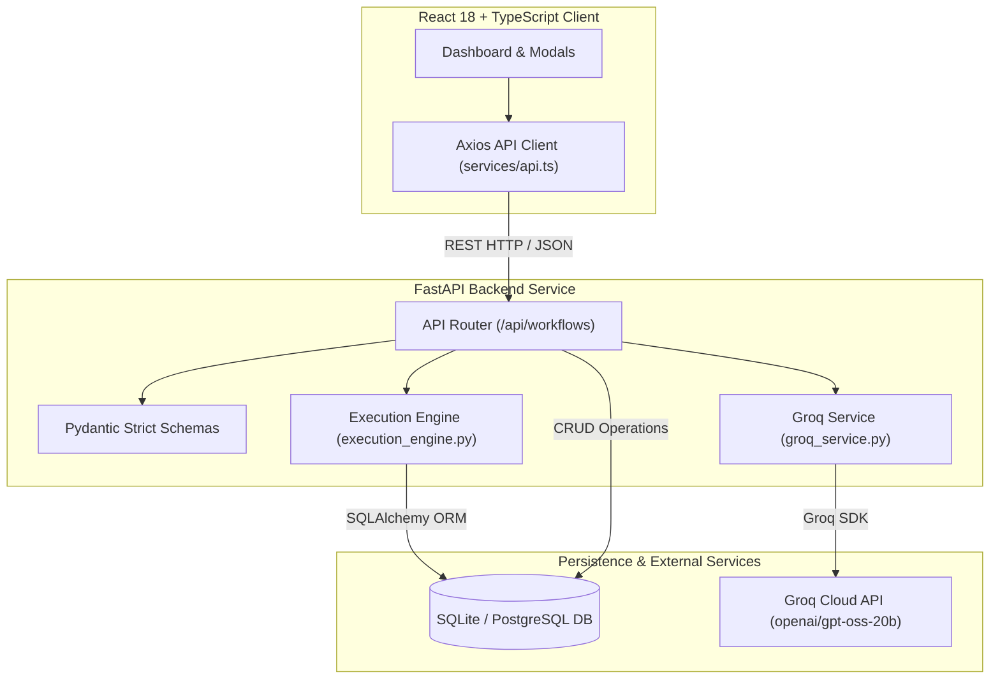
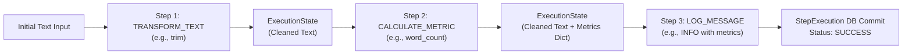

# FlowPilot — AI-Powered Workflow Automation Platform

[](https://python.org)
[](https://fastapi.tiangolo.com)
[](https://react.dev)
[](https://www.typescriptlang.org)
[](https://tailwindcss.com)
[](https://sqlite.org)
[](LICENSE)

FlowPilot is a modern full-stack SaaS workflow automation platform that allows developers and teams to create, customize, execute, and monitor sequential multi-step data pipelines. 

Users can either generate structured workflow drafts from natural language prompts using AI or build custom workflows directly using an interactive visual dashboard. Workflows run on a deterministic, safe sequential execution engine with complete audit logging and type-safe data passing.

---

## Table of Contents

- [Key Features](#key-features)
- [Architecture & Workflow Flow](#architecture--workflow-flow)
- [Tech Stack](#tech-stack)
- [Supported Action Types](#supported-action-types)
- [Project Folder Structure](#project-folder-structure)
- [Getting Started](#getting-started)
  - [Prerequisites](#prerequisites)
  - [Backend Setup (FastAPI)](#backend-setup-fastapi)
  - [Frontend Setup (React + Vite)](#frontend-setup-react--vite)
- [Environment Configuration](#environment-configuration)
- [API Documentation](#api-documentation)
- [Testing](#testing)
- [UI Screenshots](#ui-screenshots)
- [Known Limitations & Architecture Decisions](#known-limitations--architecture-decisions)
- [License](#license)

---

## Key Features

- **AI-Powered Workflow Drafting**: Describe desired automation in natural language (e.g., *"Clean input text, count the words, and log completion"*). FlowPilot translates the prompt into an ordered, strictly validated multi-step draft.
- **Safe Sequential Execution Engine**: Executes workflows sequentially using strictly predefined Python handlers. **Zero `eval` or dynamic code execution** ensures total execution safety.
- **Independent Execution (Zero API Costs)**: Running workflows requires no AI API key or third-party paid services. Manual workflows execute entirely locally and deterministically.
- **Type-Safe Pipeline Context**: Maintains an `ExecutionState` that passes text streams and structured metrics across steps without data corruption.
- **Per-Step Audit Trails & History**: Every execution logs duration in milliseconds, inputs, outputs, timestamps, and error messages. If a step fails, prior successful steps remain recorded, and execution safely halts immediately.
- **Modern Developer Dashboard**:
  - Live API connection status indicator.
  - Metrics cards (total workflows, steps configured, success/failed runs).
  - Search and status filter (All, Success, Failed, Never Run).
  - Modal workflow builder with reordering (drag/move up & down) and raw JSON editor.
  - Execution modal with sample text presets, live execution viewer, and historical run logs.

---

## Architecture & Workflow Flow

### System Architecture



### Sequential Execution Engine Pipeline



---

## Tech Stack

| Layer | Technologies | Purpose |
|---|---|---|
| **Frontend** | React 18, TypeScript, Vite, Tailwind CSS, Lucide Icons | Reactive, polished developer SaaS dashboard |
| **Backend** | Python 3.10+, FastAPI, Uvicorn, Pydantic v2 | High-performance asynchronous REST API |
| **ORM & Database** | SQLAlchemy 2.0, SQLite (default), PostgreSQL (compatible) | Relational persistence with cascade relationships |
| **AI Integration** | Official Groq Python SDK (`groq`), Model: `openai/gpt-oss-20b` | High-throughput structured workflow draft generation |
| **Execution Engine**| Predefined Python action handlers | Safe, sandboxed sequential execution without `eval` |
| **Testing** | `unittest`, `fastapi.testclient.TestClient`, `httpx` | Integration, schema validation, and regression suites |

---

## Supported Action Types

FlowPilot enforces strict parameter constraints on all pipeline steps:

| Action Type | Supported Parameters | Example Payload | Description |
|---|---|---|---|
| `TRANSFORM_TEXT` | `operation`: `"trim"`, `"uppercase"`, `"lowercase"` | `{"operation": "trim"}` | Transforms the current input string stream. |
| `CALCULATE_METRIC` | `metric`: `"word_count"`, `"char_count"`, `"line_count"` | `{"metric": "word_count"}` | Calculates numeric metrics while preserving text context. |
| `LOG_MESSAGE` | `message`: string (non-empty)<br>`level`: `"INFO"`, `"WARNING"` | `{"message": "Words: {word_count}", "level": "INFO"}` | Logs an execution message; supports `{text}` and metric interpolation. |

---

## Project Folder Structure

```text
flowpilot/
├── .gitignore                    # Root Git ignore rules (secrets, databases, node_modules)
├── README.md                     # Comprehensive project documentation
│
├── backend/                      # FastAPI Backend
│   ├── .env                      # Active environment variables (git-ignored)
│   ├── .env.example              # Environment template with SQLite default
│   ├── .gitignore                # Backend-specific ignore rules
│   ├── requirements.txt          # Python dependencies (FastAPI, SQLAlchemy, groq, httpx)
│   ├── test_api.py               # Phase 1 CRUD & integration test suite
│   ├── test_phase3.py            # Phase 3 Groq validation & schema test suite
│   ├── test_phase4.py            # Phase 4 Sequential execution engine test suite
│   └── app/
│       ├── main.py               # FastAPI application entrypoint & CORS config
│       ├── api/
│       │   ├── __init__.py       # Router aggregation
│       │   └── workflows.py      # CRUD, /generate, /{id}/run, and /{id}/executions endpoints
│       ├── core/
│       │   ├── config.py         # Pydantic Settings & environment loader
│       │   └── database.py       # SQLAlchemy engine & session factory
│       ├── models/
│       │   └── models.py         # Database models: Workflow, WorkflowStep, WorkflowExecution, StepExecution
│       ├── schemas/
│       │   └── schemas.py        # Pydantic v2 validation models & request/response schemas
│       └── services/
│           ├── execution_engine.py # Sequential execution runner & safe handlers
│           └── groq_service.py     # Groq AI prompt processing & JSON validator
│
└── frontend/                     # React + Vite Frontend
    ├── .env                      # Active frontend environment variables (git-ignored)
    ├── .env.example              # Frontend environment template
    ├── .gitignore                # Frontend-specific ignore rules
    ├── index.html                # Single-page application entrypoint
    ├── package.json              # NPM dependencies & scripts
    ├── tsconfig.json             # TypeScript configuration
    ├── tailwind.config.js        # Tailwind CSS theme configuration
    ├── vite.config.ts            # Vite bundler configuration
    └── src/
        ├── App.tsx               # Root application layout & state coordinator
        ├── main.tsx              # React DOM mounting
        ├── index.css             # Tailwind CSS directives & global styling
        ├── types/
        │   └── workflow.ts       # Shared TypeScript interfaces & types
        ├── services/
        │   └── api.ts            # Axios API client & error normalization
        ├── utils/
        │   └── formatters.ts     # Date, relative time, and badge helper utilities
        └── components/
            ├── Navbar.tsx        # Top navigation with live backend connection badge
            ├── Dashboard.tsx     # Metrics, AI generator bar, search & workflow cards
            ├── WorkflowCard.tsx  # Individual workflow card with quick-run action
            ├── WorkflowModal.tsx # Create & edit modal with step reordering & raw JSON mode
            ├── WorkflowDetailModal.tsx # Detail inspection view with historical runs
            ├── RunWorkflowModal.tsx    # Interactive execution modal with live step outputs
            ├── DeleteConfirmModal.tsx  # Confirmation modal for safe deletion
            └── Toast.tsx         # Notification toast alert system
```

---

## Getting Started

### Prerequisites

- **Python**: Version 3.10 or higher ([Download Python](https://www.python.org/downloads/))
- **Node.js**: Version 18.x or higher and `npm` ([Download Node.js](https://nodejs.org/))

---

### Backend Setup (FastAPI)

1. **Navigate to the backend directory**:
   ```bash
   cd backend
   ```

2. **Create and activate a virtual environment**:
   - On Windows (PowerShell):
     ```powershell
     python -m venv venv
     .\venv\Scripts\Activate.ps1
     ```
   - On macOS/Linux:
     ```bash
     python3 -m venv venv
     source venv/bin/activate
     ```

3. **Install dependencies**:
   ```bash
   pip install -r requirements.txt
   ```

4. **Configure environment variables**:
   ```bash
   cp .env.example .env
   ```
   *(By default, `.env.example` is pre-configured to use SQLite zero-setup database `sqlite:///./flowpilot.db`)*.

5. **Start the FastAPI backend server**:
   ```bash
   uvicorn app.main:app --reload --host 127.0.0.1 --port 8000
   ```

6. **Verify backend**:
   - Health check: [http://127.0.0.1:8000/health](http://127.0.0.1:8000/health)
   - Interactive Swagger API Docs: [http://127.0.0.1:8000/docs](http://127.0.0.1:8000/docs)

---

### Frontend Setup (React + Vite)

1. **Open a new terminal and navigate to the frontend directory**:
   ```bash
   cd frontend
   ```

2. **Install NPM packages**:
   ```bash
   npm install
   ```

3. **Configure environment variables**:
   ```bash
   cp .env.example .env
   ```
   Ensure `VITE_API_URL=http://127.0.0.1:8000`.

4. **Launch the development server**:
   ```bash
   npm run dev
   ```

5. **Open FlowPilot in your browser**:
   Navigate to [http://localhost:5173](http://localhost:5173).

---

## Environment Configuration

### Backend (`backend/.env`)

| Variable | Default Value | Description |
|---|---|---|
| `PROJECT_NAME` | `"FlowPilot API"` | API application display name |
| `PORT` | `8000` | Port for the Uvicorn web server |
| `HOST` | `"0.0.0.0"` | Host bind address |
| `DATABASE_URL` | `"sqlite:///./flowpilot.db"` | SQLite connection string (or PostgreSQL URL) |
| `CORS_ORIGINS` | `"http://localhost:5173,http://127.0.0.1:5173,http://127.0.0.1:5174"` | Allowed frontend origins |
| `GROQ_API_KEY` | `""` | Groq API key for AI generation (`openai/gpt-oss-20b`) |

### Frontend (`frontend/.env`)

| Variable | Default Value | Description |
|---|---|---|
| `VITE_API_URL` | `http://127.0.0.1:8000` | Base URL pointing to the FastAPI backend service |

---

## API Documentation

All workflow endpoints are prefixed with `/api/workflows`.

| Method | Endpoint | Description | Status Code |
|---|---|---|---|
| `GET` | `/health` | Backend service health and status | `200 OK` |
| `GET` | `/api/workflows` | List all workflows with step counts and last run status | `200 OK` |
| `POST` | `/api/workflows` | Create a new workflow with optional ordered steps | `201 Created` |
| `GET` | `/api/workflows/{id}` | Retrieve details of a workflow and its ordered steps | `200 OK` |
| `PUT` | `/api/workflows/{id}` | Update workflow title, description, or steps | `200 OK` |
| `DELETE` | `/api/workflows/{id}` | Delete a workflow (cascades steps & execution history) | `204 No Content` |
| `POST` | `/api/workflows/generate` | Generate workflow draft from natural language prompt | `200 OK` |
| `POST` | `/api/workflows/{id}/run` | Execute saved workflow sequentially with input text | `200 OK` |
| `GET` | `/api/workflows/{id}/executions` | Get execution history and step logs for a workflow | `200 OK` |

### Example Run Execution Request

`POST /api/workflows/1/run`

```json
{
  "input_text": "   Clean customer feedback review string with extra padding   "
}
```

### Example Run Execution Response

```json
{
  "id": 1,
  "workflow_id": 1,
  "status": "SUCCESS",
  "input_text": "   Clean customer feedback review string with extra padding   ",
  "error_message": null,
  "started_at": "2026-11-02T14:48:03.203433Z",
  "completed_at": "2026-11-02T14:48:03.303718Z",
  "step_executions": [
    {
      "id": 1,
      "step_order": 1,
      "action_type": "TRANSFORM_TEXT",
      "status": "SUCCESS",
      "output_data": {
        "operation": "trim",
        "result": "Clean customer feedback review string with extra padding"
      },
      "error_message": null,
      "duration_ms": 1,
      "executed_at": "2026-11-02T14:48:03.239950Z"
    },
    {
      "id": 2,
      "step_order": 2,
      "action_type": "CALCULATE_METRIC",
      "status": "SUCCESS",
      "output_data": {
        "metric": "word_count",
        "value": 7
      },
      "error_message": null,
      "duration_ms": 3,
      "executed_at": "2026-11-02T14:48:03.280324Z"
    }
  ]
}
```

---

## Testing

FlowPilot includes comprehensive automated test suites covering all backend functionality, strict schema validation, and sequential execution.

### Run All Backend Tests

Run the complete test suite from the `backend/` directory:

```bash
cd backend
python -m unittest test_phase4.py test_phase3.py -v
python test_api.py
```

- **`test_phase4.py`**: Verifies sequential step execution, intermediate output passing, type-safe metric preservation, failure halting with prior step persistence, and execution history retrieval.
- **`test_phase3.py`**: Verifies strict Pydantic validation for action types, parameter constraints, missing API key handling (HTTP 503), invalid payloads (HTTP 422), and non-automatic database persistence for AI drafts.
- **`test_api.py`**: Full integration and regression test covering health checks, creation, listing, updates, executions, and cascading deletes.

### Test Frontend Production Build

From the `frontend/` directory, verify TypeScript compilation and bundling:

```bash
cd frontend
npm run build
```

---

## UI Screenshots

| View | Description |
|---|---|
| **Dashboard & Pipeline Overview** | *Central control center displaying total workflows, configured steps, success/failure counts, search/filter controls, and workflow cards.* |
| **Workflow Builder Modal** | *Multi-step interactive form with step reordering (up/down), action configuration, and raw JSON parameters mode.* |
| **Execution Engine Modal** | *Custom input textarea, preset text buttons, real-time per-step duration and output viewer, and historical execution run logs.* |
| **Workflow Detail & History View** | *Deep inspection modal displaying metadata, original AI generation prompt, ordered pipeline steps, and previous execution audits.* |

*(Place screenshots in `docs/screenshots/` or embed directly into repository)*

---

## Known Limitations & Architecture Decisions

1. **AI Generation Engine (Groq `openai/gpt-oss-20b`)**:
   - AI generation utilizes Groq's high-speed LPU inference engine (`openai/gpt-oss-20b`) with structured JSON mode and strict Pydantic validation.
   - **Architecture Resilience**: The core Workflow Execution Engine is completely decoupled from external AI APIs. Users can create, customize, and execute unlimited workflows locally without an API key or incurring any cloud API costs.
2. **Synchronous In-Process Execution Engine**:
   - Sequential execution currently runs in-process per request. For high-throughput enterprise scalability, steps can be offloaded to asynchronous task queues (e.g., Celery/Redis) without changing the core step handler contracts.
3. **Database Portability**:
   - The application defaults to SQLite for immediate, zero-dependency local deployment and review. For production deployment, set `DATABASE_URL` in `backend/.env` to a PostgreSQL instance (`psycopg2-binary` is pre-configured).

---

## License

This project is licensed under the [MIT License](LICENSE).

